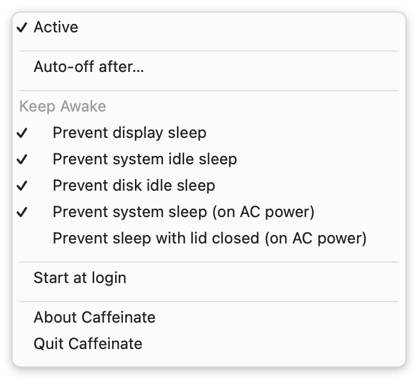

# Caffeinate

A macOS menu bar app that keeps the Mac awake for as long as you want.

This repo is `leok7v/Caffeinate`, a fork of
[LennardKittner/Caffeinate](https://github.com/LennardKittner/Caffeinate).
The fork adds a signed and notarized DMG, a Homebrew cask, and an
option that keeps the Mac awake with the lid closed.

## How it works

A left click on the cup turns Caffeinate on or off. When the cup is
full, the Mac does not go to sleep. A right click, or a Control click,
opens the menu. In the menu you pick the kinds of sleep to prevent, set
**Start at login**, and quit the app.



### Keep awake options

The first four options are the flags of the `caffeinate(8)` command
line tool. Each one turns on or off by itself. The defaults are the
same as `caffeinate -dims`.

| Menu item | `caffeinate` flag |
|-----------|-------------------|
| Prevent display sleep | `-d` |
| Prevent system idle sleep | `-i` |
| Prevent disk idle sleep | `-m` |
| Prevent system sleep (on AC power) | `-s` |
| Prevent sleep with lid closed (on AC power) | none, off by default |

### Lid closed

**Prevent sleep with lid closed (on AC power)** keeps a MacBook awake
when you close the lid, with no external display. The option needs no
`sudo` and no helper. The option applies only while Caffeinate is
active and the Mac is on AC power. Caffeinate clears it when you turn
Caffeinate off, unplug the power, quit, or launch it again.

On battery the option has no effect, so a closed MacBook in a bag
sleeps as usual and does not get hot.

The lid override stops only the sleep that the lid causes. The idle
sleep timer still applies, so the option also turns on **Prevent
system sleep (on AC power)** and locks it on while checked.

The option uses only public IOKit calls of the macOS SDK:
`IOConnectCallScalarMethod` on the power manager with the selector
`kPMSetClamshellSleepState` from `IOPMLibDefs.h`. The selector has no
documentation. If macOS refuses to set the override, Caffeinate shows
an alert and turns the option off. If macOS refuses to clear it,
Caffeinate shows an alert and tries again on the next change.

### Auto-off timer

Caffeinate can turn itself off after a set time. In the menu, open
**Auto-off after...** and pick a preset from 15 minutes to 8 hours. Or
pick **Custom...** and type a number of minutes, at most one year. Pick
**Off** to stop the timer.

With the timer on, a countdown shows next to the cup and in the
**Active** row of the menu. At zero, Caffeinate turns itself off.

 dark mode Caffeinate active
 dark mode Caffeinate inactive

 light mode Caffeinate active
 light mode Caffeinate inactive

## Requirements

macOS 13 or later, Apple Silicon or Intel. The app is a universal
binary.

## Installation

The release DMG is signed with a Developer ID certificate, notarized
and stapled. Gatekeeper accepts the app with no prompt and no `xattr`
step.

### Homebrew

```sh
brew tap leok7v/tap
brew trust leok7v/tap
brew install --cask leok7v/tap/caffeinate
```

`brew upgrade` moves you to a newer release. The tap is
[leok7v/homebrew-tap](https://github.com/leok7v/homebrew-tap).

### Download a release

Download `Caffeinate.dmg` from
[releases](https://github.com/leok7v/Caffeinate/releases), open it, and
drag `Caffeinate.app` to `Applications`.

### Build it yourself

- With Xcode: `project.yml` is the project, and `xcodegen generate`
  makes `Caffeinate.xcodeproj` from it. Then build with
  `xcodebuild -configuration Release`. Install xcodegen with
  `brew install xcodegen`.
- With the Command Line Tools only: `./scripts/make-app.sh` compiles
  the sources with `swiftc` and makes an ad-hoc signed `Caffeinate.app`
  in the repo root.

## Release

A release is a tag. `.github/workflows/dmg.yml` builds the universal
app and signs it with Developer ID. Then it notarizes and staples the
app and the DMG. Then it publishes `Caffeinate.dmg` and
`Caffeinate.dmg.sha256` as a GitHub release. The tag is the UTC time,
vYYMMDD.HHMM. Tag v261118.0830 builds version 26.11.18, build
261118.0830.

1. Set the five Actions secrets once per repo, in a Terminal window:
   `bin/secrets tmp/DeveloperID.p12`.
2. Tag and push:
   `t=v$(date -u +%y%m%d.%H%M); git tag $t && git push origin $t`.
3. When the release exists, tag `leok7v/homebrew-tap` with the same
   stamp to update the cask:

       git tag caffeinate-$t && git push origin caffeinate-$t

A manual run of the workflow builds an unsigned DMG as an artifact and
publishes nothing.

`swift scripts/make-icon.swift Caffeinate/Assets.xcassets/AppIcon.appiconset`
makes the icon PNGs from the `cup.and.saucer` SF Symbol.
`swift scripts/make-screenshots.swift Images` makes the README images.

## FAQ

**How do I quit?**

Right-click the cup and choose **Quit Caffeinate**.

## Links

[CPUMonitor menu bar app](https://github.com/LennardKittner/CPUMonitor)

[ClipBoardManager menu bar app](https://github.com/LennardKittner/ClipBoardManager)
